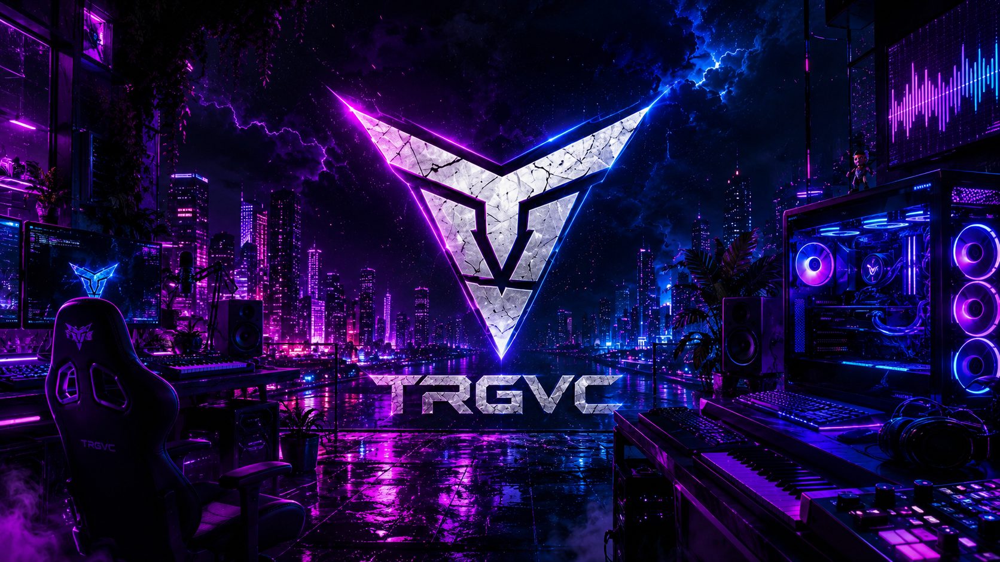

  

  # TRGVC — The Real Gameplay Video Channel
  **Official Hub for TRGVC Music & TRGVC Gaming**

  
  
  
  

---

## Overview

Official source repository for **[trgvc.club](https://trgvc.club)** — the central digital hub for **TRGVC (*The Real Gameplay Video Channel*)**.

* **TRGVC Music:** Original studio albums and music releases with interactive Spotify album players, full tracklist modals, and instant song search (`/`).
* **TRGVC Gaming:** High-quality PC gameplay, full campaign walkthroughs, and competitive multiplayer action synced automatically in newest-first order from YouTube.
