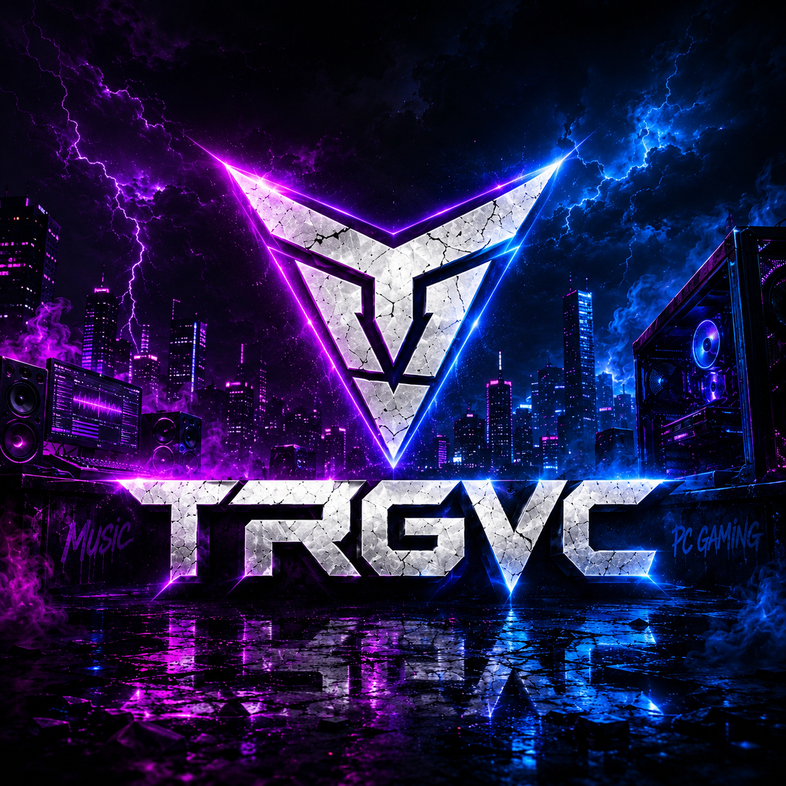

<div align="center">
  <a href="https://trgvc.club">
    
  </a>

  # TRGVC — The Real Gameplay Video Channel
  **Official Hub for TRGVC Music (Club, Party & Festival Bangers) & TRGVC Gaming**

  [](https://trgvc.club)
  [](https://www.youtube.com/channel/UCTJMtzodlcDEYt38qR_0cxQ)
  [](https://open.spotify.com/artist/4r17VtPq9uwHDU81ER0E9o)
  [](https://steamcommunity.com/id/stbvideo)
</div>

---

## Overview

Welcome to the official source repository for **[trgvc.club](https://trgvc.club)** — the central digital hub for **TRGVC (*The Real Gameplay Video Channel*)**.

>"The revolution isn't coming—it's already playing. You just have to turn it up."

Built with zero external framework bloat, this site unites both sides of the **TRGVC** brand into a fast, pitch-black dashboard deployed on **Cloudflare Pages**:
1. **TRGVC Music:** High-energy UK Bassline, Bass House, Vocal Trance, and EDM festival bangers with full interactive Spotify album players, tracklist modals, and instant song search.
2. **TRGVC Gaming:** Native 2K QHD (1440p @ 60FPS) PC gameplay, walkthroughs, and custom weapon loadouts synced automatically in chronological order from YouTube.

---

## Key Features & Architecture

* **Dual-Hub Filtering (`All Content` | `TRGVC Music` | `TRGVC Gaming`):** Visitors can explore the complete ecosystem or isolate Music or Gaming with a single click.
* **Real-Time YouTube Playlist Auto-Sync (Newest First):**
  * **TRGVC Music Playlist:** [`PL5mv7FjsynbzKMH3jYHHn2i7EziEFpo7-`](https://www.youtube.com/playlist?list=PL5mv7FjsynbzKMH3jYHHn2i7EziEFpo7-)
  * **TRGVC Gaming Playlist:** [`PLGLaDUSam8Cs`](https://www.youtube.com/playlist?list=PLGLaDUSam8Cs)
  * Powered by a serverless Cloudflare Edge Function (`/api/youtube`) that fetches and parses live YouTube feeds and playlist order while automatically filtering out YouTube Shorts.
* **Interactive Spotify Discography & Tracklist Modal:** Features all **5 published 2026 studio albums** with official Spotify cover art, an in-page album/track switcher, and a pop-up tracklist modal to preview any of the **70+ tracks** on the spot.
* **Instant Live Song Search (`/` Shortcut):** Search across all 71 indexed TRGVC songs by title or album and jump straight to the embedded Spotify player or album tracklist.
* **60FPS Studio Frequency Visualizer & Cinema Mode:** Hardware-accelerated HTML5 `<canvas>` audio spectrum visualizer in the hero header plus a one-click Theater Cinema Dimmer.
* **Rich SEO & Artist Schema:** Full Open Graph, X/Twitter Card, and `Schema.org/MusicGroup` + `MusicAlbum` JSON-LD structured data.

---

## 2026 Studio Discography

| Album Title | Release Date | Tracks | Stream on Spotify |
| :--- | :--- | :---: | :--- |
| **On Tonight** *(Upcoming)* | 1 December 2026 | Lead Single: *"Turn It Up Louder"* | [Preview on YouTube](https://www.youtube.com/watch?v=_9-fsug6184) |
| **When the Lights Don't Lie** | September 2026 | 14 Songs (53m 43s) | [Listen on Spotify](https://open.spotify.com/album/2pYr1NYOShOIZ3zMRmfVVV) |
| **Signals in the Dark** | May 2026 | 14 Songs (51m 27s) | [Listen on Spotify](https://open.spotify.com/album/4AC3K4l4IN7mg8Ttu57tCx) |
| **Pulse of the Night** | April 2026 | 10 Songs (42m 40s) | [Listen on Spotify](https://open.spotify.com/album/06l7DRPWtlW0LC3tgCxRsJ) |
| **Velocity Horizon** | March 2026 | 15 Songs (1h 09m) | [Listen on Spotify](https://open.spotify.com/album/0dq1fWEkpHQAHCLto4FB2m) |
| **The Digital Sunrise** | February 2026 | 17 Songs (1h 05m) | [Listen on Spotify](https://open.spotify.com/album/3wj0OkKqr1DJ9pjOwQBWT7) |

---

## TRGVC Gaming — PC Hardware & Capture Specs

* **Target Resolution & Framerate:** 2K QHD (1440p @ 60FPS)
* **Graphics Card:** ASUS NVIDIA GeForce RTX 4060 Ti
* **Processor:** Intel Core i7-10700
* **Memory & Audio:** 32GB RAM + Logitech G535 LIGHTSPEED Wireless
* **Capture & Encoding Pipeline:** OBS Studio (NVENC Hardware Encoding, CQP Rate Control, Hybrid MP4)

---

## Repository Structure

```text
newtrgvc/
├── index.html               # Main application (HTML5, CSS3, 60FPS Canvas Visualizer, Song Search & Modal JS)
├── logoback.png             # Official TRGVC hero banner & Open Graph social preview image
├── favicon.svg              # Vector V-Shield neon emblem favicon
├── robots.txt               # Search engine & social preview crawler rules
├── sitemap.xml              # XML sitemap for Google Search Console indexing
├── _headers                 # Cloudflare Pages security & framing headers
└── functions/
    └── api/
        └── youtube.js       # Cloudflare Pages Edge Function for live YouTube playlist & channel syncing
